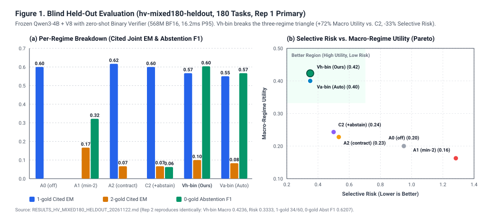
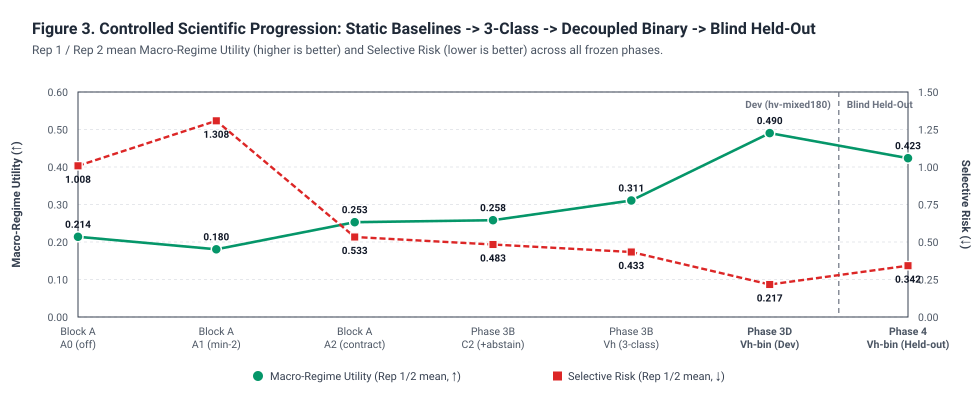

# EvidenceAgent-RL

**Replayable Evidence Firewall, Pre-Registered Controls, and Decoupled Binary Sufficiency Verification for Grounded Retrieval Agents**

[](https://github.com/taruki11/evidenceagent-rl-code/actions/workflows/ci.yml)

`EvidenceAgent-RL` is a deterministic, zero-dependency core harness and pre-registered evaluation framework for tool-using retrieval agents operating across mixed-evidence regimes:
- **1-gold**: single-document answerable queries;
- **2-gold**: multi-hop queries requiring citations from two distinct documents;
- **0-gold**: unanswerable queries where the corpus lacks the answer-bearing document and the agent should explicitly abstain.

---

## Key Highlights (Blind Held-Out Evaluation, Phase 4)

On our strictly zero-overlap blind held-out set (`hv-mixed180-heldout`, 180 tasks = 60 `1-gold` + 60 `2-gold` + 60 `0-gold`, evaluated across 2 symmetric reverse-ordered repetitions = 2,160 episodes, 0 hard errors, zero held-out tuning):

| Arm (Rep 1 / Rep 2) | Macro-Regime Utility (↑) | Selective Risk (↓) | 1-gold (/60) | 2-gold (/60) | 0-gold Explicit (/60) | 0-gold Abst F1 | 0-gold Halluc (/60) |
|---|---:|---:|---:|---:|---:|---:|---:|
| `A0` (unconstrained) | 0.2000 / 0.2000 | 0.9500 / 0.9667 | 36 / 36 | 0 / 0 | 0 / 0 | 0.000 / 0.000 | 55 / 56 |
| `A1` (blanket min-2) | 0.1627 / 0.1595 | 1.2833 / 1.2667 | 0 / 0 | **10 / 10** | 18 / 17 | 0.321 / 0.312 | 21 / 20 |
| `A2` (public contract) | 0.2278 / 0.2222 | 0.5333 / 0.5333 | **37 / 37** | 4 / 3 | 0 / 0 | 0.000 / 0.000 | 30 / 30 |
| `C2` (contract + early abstain) | 0.2431 / 0.2486 | 0.5000 / 0.5333 | 36 / 36 | 4 / 5 | 2 / 2 | 0.063 / 0.063 | 26 / 28 |
| **`Vh-bin` (Ours, hint)** | **0.4234 / 0.4236** | **0.3500 / 0.3333** | 34 / 34 | 6 / 5 | **35 / 36** | **0.603 / 0.621** | **17 / 16** |
| `Va-bin` (Ours, auto) | 0.4000 / 0.4173 | 0.3500 / 0.3500 | 33 / 34 | 5 / 6 | 34 / 36 | 0.567 / 0.585 | 17 / 17 |

- **+72% relative Macro-Regime Utility** over the strongest baseline (`C2`: `0.2431/0.2486` → `0.4234/0.4236`), passing pre-registered **H-Macro** and **H-1gold** (`p = 1.16e-10` vs. `A1`).
- **-33% Selective Risk** (`0.5000/0.5333` → `0.3500/0.3333`) and **0-gold Explicit Abstention F1 = 0.603 / 0.621** (`p < 1e-9` vs. `A0/A2/C2`, `p <= 0.0023` vs. `A1`).
- **Lightweight Binary Verifier**: 568M `BAAI/bge-reranker-v2-m3` (BF16 autocast) achieves **0.957–0.962 dev macro-F1** (`distinct=1: 0.967–0.987`, `distinct=2: 0.930–0.935`), **ECE ≤ 0.013**, and **16.2 ms P95 latency** co-located with vLLM on a single 48 GB GPU.
- **Honest Boundaries**: `Vh-bin` does not clear the strict `p < 0.001` hallucination clause against `A2/C2` at `n = 60` (`p = 0.035/0.016` vs. `A2`), and 2-gold cited EM (`6/5`) remains below schema-enforced `A1` (`10/10`), reflecting the 4B policy's multi-hop retrieval ceiling.

---

## Core Findings & Visual Summary

### 1. Blind Held-Out Three-Regime Tradeoff & Pareto Frontier


### 2. Why 3-Class Verifiers Deadlock vs. Decoupled Binary Sufficiency Control


### 3. Controlled Four-Phase Scientific Progression


---

## Architecture & Repository Layout

- `src/evidence_agent_rl/harness.py` & `skills.py`: Deterministic, replayable `EvidenceHarness` enforcing the **Evidence Firewall** (strategy memory can guide search/stop but can never enter citation chains) and the **Bounded-Repair → Abstain** state machine.
- `src/evidence_agent_rl/sufficiency_verifier.py`: Dependency-light interfaces for binary/ternary external sufficiency verification (`format_verifier_text`, temperature calibration, `LocalSufficiencyVerifier`, `HTTPSufficiencyVerifier`, `ScriptedSufficiencyVerifier`).
- `src/evidence_agent_rl/claim_support.py` & `public_contract.py`: Gold-free local claim-support guard and public question-derived support contracts.
- `scripts/audit_hv_failure_funnel.py`: Zero-GPU mutually exclusive 6-bucket failure-funnel auditor.
- `scripts/generate_paper_figures.py`: Zero-dependency SVG figure generator backed by frozen audit metrics.
- `tests/`: Fast offline unit tests covering the Evidence Firewall, claim-support guard, public contracts, bounded repair, failure-funnel audit, and offline demo.

---

## Quick Start (Zero-Dependency Offline Verification)

```bash
pip install -e .

# Run offline unit tests
python -m unittest discover -s tests -v

# Run deterministic offline demo
python -m evidence_agent_rl.demo

# Regenerate publication-quality SVG figures
python scripts/generate_paper_figures.py
```

## License

MIT License — see [LICENSE](LICENSE).
