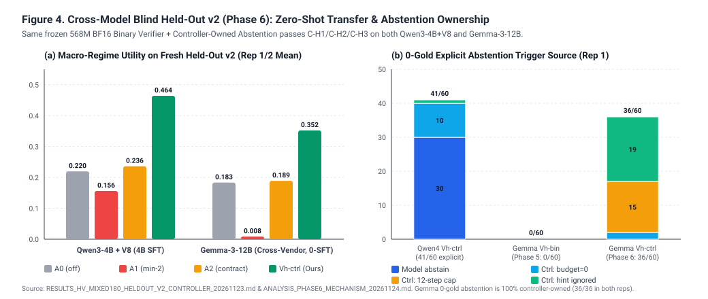

# EvidenceAgent-RL

**Replayable Evidence Firewall, Pre-Registered Controls, and Decoupled Binary Sufficiency Verification with Controller-Owned Abstention**

[](https://github.com/taruki11/evidenceagent-rl-code/actions/workflows/ci.yml)

`EvidenceAgent-RL` is a deterministic, zero-dependency core harness and pre-registered evaluation framework for tool-using retrieval agents operating across mixed-evidence regimes:
- **1-gold**: single-document answerable queries;
- **2-gold**: multi-hop queries requiring citations from two distinct documents;
- **0-gold**: unanswerable queries where the corpus lacks the answer-bearing document and the agent must explicitly abstain.

---

## Key Highlights: Cross-Model Zero-Shot Transfer (`Phase 6`, Held-Out v2)

When plugging the same frozen **568M BF16 Binary Sufficiency Verifier** (`0.954–0.962` dev macro-F1, `ECE <= 0.013`, `16.3 ms` P95 latency) zero-shot into a cross-vendor model with **zero task SFT** (`google/gemma-3-12b-it`), Phase 5 revealed a **policy-owned abstention failure**: Gemma ignored abstain hints and exhausted the 12-decision cap (`0/60` explicit abstentions). Transferring terminal exploration-exhausted abstention ownership to the deterministic harness (`controller_abstain_on_exhaustion=true`, `Vh-ctrl`) resolves this completely on a fresh zero-overlap blind held-out set (`hv-mixed180-heldout-v2`, 16 runs / 2,880 episodes, 0 hard errors):

| Base Model (Zero-Shot Verifier Reuse) | Arm (Rep 1 / Rep 2) | Macro Utility (↑) | Selective Risk (↓) | 1-gold (/60) | 2-gold (/60) | 0-gold Explicit (/60) | 0-gold Halluc (/60) |
|---|---|---:|---:|---:|---:|---:|---:|
| **`Qwen3-4B+V8`** (4B Task SFT) | `A0` (unconstrained) | 0.2222 / 0.2167 | 0.9833 / 0.9667 | **40 / 39** | 0 / 0 | 0 / 0 | 57 / 56 |
| **`Qwen3-4B+V8`** | `A1` (blanket min-2) | 0.1508 / 0.1614 | 1.4667 / 1.4500 | 0 / 0 | **10 / 11** | 16 / 17 | 30 / 29 |
| **`Qwen3-4B+V8`** | `A2` (public contract) | 0.2333 / 0.2389 | 0.4833 / 0.4500 | 36 / 37 | 6 / 6 | 0 / 0 | 25 / 23 |
| **`Qwen3-4B+V8`** | **`Vh-ctrl` (Ours)** | **0.4611 / 0.4670** | **0.3000 / 0.2833** | 36 / 37 | **10 / 10** | **41 / 42** | **13 / 12** |
| **`Gemma-3-12B`** (Cross-Vendor, 0-SFT) | `A0` (unconstrained) | 0.1833 / 0.1833 | 0.9000 / 0.8833 | **33 / 33** | 0 / 0 | 0 / 0 | 50 / 50 |
| **`Gemma-3-12B`** | `A1` (blanket min-2) | 0.0111 / 0.0056 | 1.1000 / 1.1000 | 0 / 0 | 2 / 1 | 0 / 0 | 6 / 6 |
| **`Gemma-3-12B`** | `A2` (public contract) | 0.1944 / 0.1833 | 0.6333 / 0.6500 | 32 / 30 | **3 / 3** | 0 / 0 | 34 / 35 |
| **`Gemma-3-12B`** | **`Vh-ctrl` (Ours)** | **0.3480 / 0.3560** | **0.1333 / 0.1333** | 32 / 32 | 0 / 1 | **36 / 36** | **3 / 3** |

- **All three pre-registered gates (`C-H1`, `C-H2`, `C-H3`) PASS on both models and both repetitions**:
  - **`Qwen3-4B+V8`**: **+97% Macro Utility** vs. `A2` (`0.2389 → 0.4670`), `1-gold` preserved (`36/37`, `p <= 2.91e-11` vs. `A1`), `2-gold` matches `A1` (`10/10` vs. `10/11`), `0-gold` explicit abstention F1 `0.6165 / 0.6176` (`p ~ 1e-12`).
  - **`Gemma-3-12B`** (zero task SFT, 3× scale): **+85% Macro Utility** vs. `A2` (`0.1944 → 0.3560`), **-79% Selective Risk** vs. `A2` (`0.6333 → 0.1333`), `1-gold` preserved (`32/32`, `p = 4.66e-10` vs. `A1`), `0-gold` explicit abstentions jump from `0/60` (Phase 5) to **`36/60`** (`F1 = 0.5106 / 0.5180`, `p = 2.91e-11`), cutting hallucinations to **`3/60` (5%)** (`p = 1.42e-14` vs. `A0`, `p <= 3.67e-8` vs. `A2`).
- **Mechanism Breakdown (`Phase 6C`)**: Read-only trace decomposition proves Gemma issues **0/60** model-side `abstain` calls; all `36/36` `0-gold` explicit abstentions are **100% controller-owned** (`2/2` via `budget=0`, `15/14` via 12-decision limit, `19/20` via hint-ignored takeover). Only `2/60` `Vh-ctrl` failures on Gemma `2-gold` occur after full support selection; the `0–3/60` `2-gold` ceiling across all arms is a zero-SFT multi-hop planning bottleneck (`36–42/60` selection misses, `10–14/60` retrieval misses).

### Blind Held-Out v1 (`Phase 4`, Single-Model Baselines)

On `hv-mixed180-heldout` (`Qwen3-4B+V8`, 6 arms × 2 reps = 2,160 episodes, 0 hard errors): `Vh-bin` lifts Macro Utility by **+72%** over the strongest baseline `C2` (`0.2431/0.2486 → 0.4234/0.4236`), reduces Selective Risk by **-33%** (`0.5000/0.5333 → 0.3500/0.3333`), preserves `1-gold` (`34/34` vs. `A0 36/36`), and lifts `0-gold` explicit abstention F1 from `0.0625/0.3214` to `0.6034/0.6207` (clearing `p < 0.05` vs. `A2` hallucination at `p = 0.035/0.016`, missing only the overly strict pre-registered `p < 0.001` clause at `n = 60`).

---

## Core Findings & Visual Summary

### 1. Cross-Model Blind Held-Out v2 & Abstention Ownership (`Phase 6 / 6C`)


### 2. Blind Held-Out v1 Three-Regime Tradeoff & Pareto Frontier (`Phase 4`)


### 3. Why 3-Class Verifiers Deadlock vs. Decoupled Binary Sufficiency Control (`Phases 3B–3D`)


### 4. Controlled Six-Phase Scientific Progression


---

## Architecture & Repository Layout

- `src/evidence_agent_rl/harness.py` & `skills.py`: Deterministic, replayable `EvidenceHarness` enforcing the **Evidence Firewall** (strategy memory can guide search/stop but can never enter citation chains) and the **Controller-Owned Bounded-Repair → Abstain** state machine.
- `src/evidence_agent_rl/sufficiency_verifier.py`: Dependency-light interfaces for binary/ternary external sufficiency verification (`format_verifier_text`, temperature calibration, `LocalSufficiencyVerifier`, `HTTPSufficiencyVerifier`, `ScriptedSufficiencyVerifier`).
- `src/evidence_agent_rl/claim_support.py` & `public_contract.py`: Gold-free local claim-support guard and public question-derived support contracts.
- `scripts/audit_hv_failure_funnel.py`: Zero-GPU mutually exclusive 6-bucket failure-funnel auditor.
- `scripts/generate_paper_figures.py`: Zero-dependency SVG figure generator backed by frozen audit metrics.
- `tests/`: Fast offline unit tests covering the Evidence Firewall, claim-support guard, public contracts, bounded repair, failure-funnel audit, and offline demo.

---

## Quick Start (Zero-Dependency Offline Verification)

```bash
pip install -e .

# Run offline unit tests
python -m unittest discover -s tests -v

# Run deterministic offline demo
python -m evidence_agent_rl.demo

# Regenerate publication-quality SVG figures
python scripts/generate_paper_figures.py
```

## License

MIT License — see [LICENSE](LICENSE).
